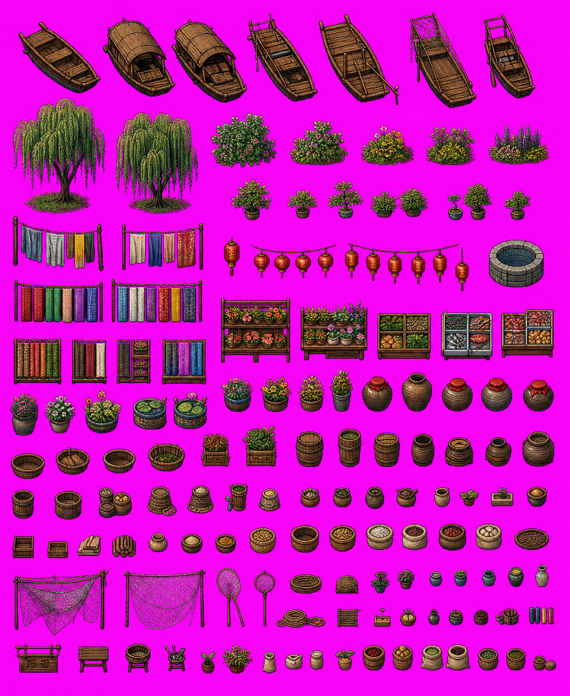

**中文** | [English](./README.md)

<p align="center">
  
</p>

<h1 align="center">G-Studio</h1>

<p align="center"><strong>轻量级游戏资源工作台</strong> — 切图、拼图、画区域、编地图，一站搞定。</p>

**[在线体验](https://huzz-open.github.io/g-studio/)** · [GitHub](https://github.com/huzz-open/g-studio)

---

G-Studio 是一个运行在浏览器中的游戏开发辅助工具集，专为 2D 游戏（特别是 Godot 引擎项目）设计。基础编辑功能和资产保存在本地，无需登录。可选模型生成支持本地服务或公网中转；中转任务的图片与模型会经过所配置的服务器。

## 试一试

[`samples/`](./samples/) 目录中包含一张测试用的 Sprite Sheet：



打开切图工具模块，将这张图片拖入，即可体验自动检测切割功能。

## 功能模块

| 模块 | 说明 |
|------|------|
| **模型生成** | 轮廓近似或调用本地 AI，预览后保存为部件；支持 HTTP 直连和 WSS 中转 |
| **资源管理器** | 浏览本地工作区目录，管理图片和数据文件，查看元数据 |
| **切图工具** | 从 Sprite Sheet 中自动/手动切割动画帧、图标和物件 |
| **地图编辑器** | 编辑世界地图，放置地点、绘制道路和区域 |
| **Tileset 生成器** | 从纹理或九宫格素材生成 47-tile 自动地形图集，导出 Godot `.tres` |
| **场景区域编辑器** | 在场景背景图上绘制碰撞/遮挡区域，导出 Godot `.tscn` |

## 快速开始

### 环境要求

- [Node.js](https://nodejs.org/) >= 22.12（当前 Vite 8 的兼容要求为 `^20.19.0 || >=22.12.0`）
- npm（随 Node.js 安装）；也可使用 pnpm

### 安装与运行

```bash
git clone https://github.com/huzz-open/g-studio.git
cd g-studio
npm install
npm run dev
```

浏览器打开 `http://localhost:5173` 即可使用。

`npm run dev` 默认同时启动网页和 Python 生成服务。首次自动准备隔离 Python 3.12 环境、推理依赖及约 **4.2GB** 的 Hunyuan3D-2mini-Turbo 权重，并校验文件；无需手动安装 Python、执行 pip 或逐个下载模型。依赖安装另需空间与时间，网页会先启动，模型准备期间仍可使用基础功能。再次启动复用缓存；按 Ctrl+C 退出本次启动的进程。Windows 用户也可双击根目录 `start-generation.cmd`，其它平台可运行 `sh start-generation.sh`。

默认优先检测并使用兼容 NVIDIA GPU，无法使用时回退 CPU；启动日志明确打印检测到的显卡类别、运行时结果及最终 CPU/GPU。本机 Windows CPU 路径已实测，NVIDIA 和 Linux 路径需在对应硬件上进一步验证，不把 Intel 核显当作 CUDA GPU。

在 **设置 → 模型生成 → 连接服务** 中选择“直连接口”，点击“测试连接”。本地开发自动取得连接凭证，并显示 **计算设备：CPU / GPU**。初始生成方式仍为“轮廓近似”；启动服务不会自动上传图片。进入“模型生成”菜单选择图片，或在部件编辑器点击“生成几何”，完成后先预览再应用。保存的模型部件可离线使用，不依赖服务永久在线。

| 命令 | 用途 |
| --- | --- |
| `npm run dev:web` | 只启动网页，不准备 Python 或下载模型 |
| `npm run generation:start` | 仅启动生成服务，供已部署的网页使用 |
| `npm run generation:download` | 提前下载并校验模型 |
| `npm run generation:doctor` | 检查运行环境及服务连通性 |
| `npm run relay:start` | 启动轻量 TS 中转后端，不运行 AI |

模型、环境与临时任务默认位于用户目录 `~/.g-studio/generation`，可用 `GEN_HOME` 更改。下载失败可重试并续传。端口占用时，停止自己的旧实例或配置 `GEN_PORT` / `GEN_WEB_PORT`。内存不足时可降低网格分辨率、关闭其它高内存任务，或改用远程算力/轮廓近似。CPU 推理可能需要数分钟，不能保证所有机器相同速度。

公网服务器无 GPU 时，可以只托管网页和 TS 中转；用户本机运行：

```bash
npm run generation:start -- --relay wss://你的域名/generation/worker --pair
```

在网页“公网中转”模式填写中转 HTTPS 地址和终端显示的 8 位码，再在本地终端核对请求编号并输入 `y`。短码有效 5 分钟、一次使用；长期设备凭证自动保存在本机配置中。下次启动可省略 `--pair`，沿用相同缓存目录和中转地址。图片及模型会经中转服务器临时保存，默认 24 小时；绑定浏览器可以撤销授权。直连模式无需公网中转，但公网网页访问 localhost 可能需要浏览器本地网络权限。

详见[本地服务启动与配置](./services/generation-python/README.md)、[公网中转部署](./services/generation-relay/README.md)、[生成协议](./packages/generation-protocol/README.md)和[完整方案](./docs/model-generation-service-plan.md)。模型下载遵循[上游代码](https://github.com/Tencent-Hunyuan/Hunyuan3D-2)与[模型条款](https://huggingface.co/tencent/Hunyuan3D-2mini)，不自动继承本项目许可证。

### 构建

```bash
npm run build
```

产物输出到 `dist/` 目录，可部署为纯静态站点；构建不启动 Python、不下载模型。WSS 中转需要另外运行 TS 服务，纯静态托管不能承载长连接后端。

## 光照与编辑功能

### 精灵法线与光照

切图后，通过部件的“放大查看”进入预览：按住右键临时打光，松开关闭；点击左下角灯泡可持续持灯，再次点击关闭。开启灯光时自动展开右侧参数浮层，支持检查法线图、调整生成参数和预览灯光。浮层可折叠，再次开启灯光即可重新展开。

法线参数按部件独立保存，未配置的部件使用默认参数；修改过的参数旁提供单项重置按钮。配置随 `.gs` 工程保存，预览灯光不改变原图。导出区开启“同时导出法线”后，散件 ZIP 中包含每个部件的 `名称.png` 与 `名称_normal.png`；合成图使用相同排布生成一张配套的 `_normal.png`。本地导出与工作区输出使用相同规则。

法线是从透明轮廓和颜色明暗推算的浮雕，不识别建筑真实几何。生成在后台线程完成，灯光预览需要 WebGL。算法许可随构建输出在 `licenses/sprite-normals.txt` 中。

灯光面板的“投影预览”默认关闭。开启后，素材表面受光和独立地面上的投影共用同一个点光源位置与高度。遮挡模型是透明轮廓的等厚挤出体，厚度固定为素材长边的 10%，不透明度至少 50% 的像素参与遮挡；这不是建筑真实高度或法线高度场的重建。投影使用点光源到 z=0 平面的透视投影：`Pground = (Lz * Pxy - Pz * Lxy) / (Lz - Pz)`，通过投影顶面、底面和轮廓侧壁的并集得到可见性，不使用独立的影长拉伸参数。光源在遮挡高度以下时，以齐次坐标处理延伸到视口之外的投影。

轮廓几何在后台生成并复用，移动灯光和调节灯高仅更新 GPU 渲染。地面只在投影预览中出现；关灯或查看原图／法线会隐藏地面。此功能不改变颜色图、法线图及其导出内容。`tests/shadow-preview.e2e.cjs` 将 GPU 投影与独立的光线／像素柱体求交结果比较，并检查灯高、透明边缘和模式切换。

生成器回归测试：`pnpm test:normals`。浏览器回归测试位于 `tests/normal-preview.e2e.cjs`，先启动开发服务器，再设置 `NORMAL_TEST_URL`（默认 `http://127.0.0.1:5178/`），使用已有 Playwright 环境运行。可通过 `PLAYWRIGHT_MODULE` 指定模块路径、`NORMAL_TEST_BROWSER` 指定浏览器可执行文件；测试使用隔离浏览器和临时工作区，不操作用户工作区。

### 独立几何验证

`#/experiments/umbrella-shadow` 是独立的伞模型验证页，不改变素材预览的实现。模型由浅圆锥伞面和细圆柱伞杆组成，比例为手工设定，未从原始 PNG 自动重建。点光源使用六面立方体深度图生成地面阴影和自阴影；正交／透视相机用于检查视角关系。左键在地面拖动灯位、右键旋转视角，面板可以调整灯高及几何尺寸。边缘过滤是 PCF 抗锯齿，不是面积光源的物理软阴影。

`tests/umbrella-proxy.test.cjs` 检查几何和相机拾取；`tests/umbrella-proxy.e2e.cjs` 对比 GPU 阴影与独立的光线／三角形求交，并验证相机改变不改变世界中的阴影。浏览器测试使用开发服务（`UMBRELLA_TEST_URL`，默认 `http://127.0.0.1:5188/`）及现有 Playwright 环境。

### 参数更新与计算

参数计算使用共享的 `createLatestTask` 调度器：每个任务可以配置即时、节流、防抖或提交后计算，以及耗时自适应的间隔范围。共享输入控件通过 `update:modelValue` 即时更新数值，通过 `commit` 通知业务在松手或确认输入时提交最终值。参数驱动的切图、去背、PNG 生成和瓦片生成在后台 Worker 中执行；法线预览复用同一调度机制。轻量灯光及区域属性继续即时更新。

调度回归测试：`pnpm test:compute`。`tests/processing-workers.e2e.cjs` 使用与侧栏浏览器测试相同的 Playwright 环境，检查后台结果与原算法一致、连续拖动最终值和计算期间的主线程响应。

## 浏览器兼容性

模型生成的实现范围、真实 CPU 推理耗时、TLS 中转与离线部件验证见[验证记录](./docs/model-generation-validation.md)。

G-Studio 使用 [File System Access API](https://developer.mozilla.org/en-US/docs/Web/API/File_System_Access_API) 读写本地目录。推荐使用：

- Chrome / Edge >= 86
- 其他浏览器可在"仅浏览器模式"下使用（数据存储在 IndexedDB，不持久化到磁盘）

## 技术栈

- Vue 3 + TypeScript + Vite
- Vue Router（Hash 模式）
- IndexedDB + File System Access API（双层存储）
- OpenCV.js（图像处理）

## 许可证

[Apache License 2.0](./LICENSE)
