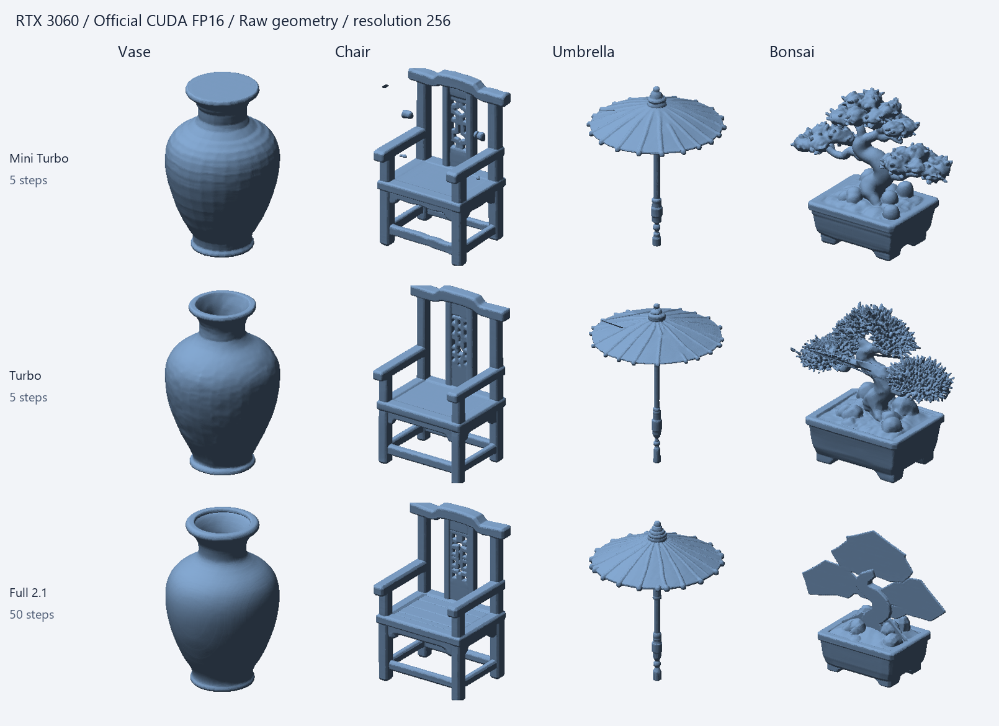

# Windows / RTX 3060 官方推理对照（2026-10-28）

[历史索引](README.md) · [当前文档](../README.md)

状态：本轮 CUDA 模型实验完成，质量问题与服务容量策略问题仍开放。代码基线 `12110cfcb137bcd96884e17ad2fe9bc3e8bd07c4`。共完成 50 次真实生成和 6 次同 latent 解码对照（其中固定上游分层解码两次失败，原样记录）。不将 Mac/MPS 的历史结果作为 CUDA 验收证据。

结论：三个模型均可在 RTX 3060 12 GB 上**单独**常驻，当前项目容量策略却会拒绝它们。两个 Turbo 的项目推理没有表现出明确优势，应优先采用官方 Pipeline/FlashVDM；低内存加载和 2.1 分层坐标修正则有实测收益，适合收敛为有回归证据的最小适配。完整 2.1 的盆景薄片退化在官方 CUDA 路径也复现，仍不能判为质量通过。

[机器数据与完整参数](model-generation-cuda-20261028.json)；本机原始日志、GLB 和 latent 位于 `output/cuda-official-20261028/`。



## 方法

- 设备：Windows 11、NVIDIA GeForce RTX 3060 12 GB、16 GB 系统内存，驱动 595.97。Python 3.12.12、PyTorch 2.6.0+cu124、torchvision 0.21.0+cu124；其他推理依赖沿用固定清单。这里验证的是固定官方代码在本项目依赖组合上的表现，不是完全复刻官方 2.1 的 Python 3.10 / PyTorch 2.5.1 环境。
- 官方组直接调用固定上游 `Hunyuan3DDiTFlowMatchingPipeline.from_pretrained()` 与 `Pipeline(...)`。逐文件校验上游 Python 源码 SHA256，不使用项目 `Engine`、meta/assign 加载、CPU FP32 图像预处理或自定义 2.1 解码器。
- Mini 与标准 Turbo 通过官方 `ShapeVAE.from_pretrained()` 加载各自已校验的 Turbo VAE，再调用 `enable_flashvdm(replace_vae=False)`。这是为了适配本地缓存目录名称；没有修改 VAE 计算。2.1 使用自身完整 checkpoint 与官方默认解码器，不混用 Turbo 权重。
- 对照组使用现有项目 `Engine`，直接测试同一常驻实例的推理，排除 HTTP、排队和文件减面开销；这不是端到端服务验收。
- 相同素材：`public/scene-lighting/{vase,chair,umbrella,bonsai}.png`，保留原始透明背景。CUDA FP16，guidance=5，seed=12345，每次创建相同 CUDA generator。各模型使用自身默认步数：Mini/Turbo 5 步，完整 2.1 50 步。
- 主对照分辨率 256（为对齐既有项目测试，并非官方 Pipeline 默认值）。另测官方默认分辨率 384。解码块与 `mean/merge` 单变量扫描单独记录，不把不同参数的速度当成模型本身的差异。
- 同一分辨率参数不代表不同解码器使用完全相同的查询网格：2.0 FlashVDM 在 256 参数下打印 63→126→252 层级，2.1 默认稠密解码查询 `(256+1)^3` 个点。两种算法的耗时与输出不能视为逐点相同的任务。
- 每个模型独立进程、单一 Pipeline；主序列为花瓶、重复花瓶、椅子、纸伞、盆景、再次花瓶。记录实例 ID 和加载次数。失败原样记录，不切换设备或精度，不自动重试为另一策略。
- GPU 阶段同步计时；保留首次与连续执行、原始 GLB、文件 hash、四视图、PyTorch allocated/reserved 峰值、进程 RSS。PyTorch 张量显存不等于显卡总占用，RSS 不含全部分页提交量；这些数值不能直接相加。
- 本机有桌面应用及其他开发活动；资源下载与部分加载阶段重叠，加载延迟和系统内存峰值受环境影响。运行中共享 Python 环境依赖曾改变；Mini 第一组完成后将相同版本依赖安装到忽略目录，通过 `PYTHONPATH` 隔离，记录该边界。
- Mini 第一组未显式设置 CPU 线程数；项目 Engine 固定 4 线程，后续官方扫描、Turbo 和 2.1 显式使用 4 线程。比较以数量级、阶段分解及受控扫描为主，不用小样本的几个百分点差异宣称速度胜负。

实验入口：[generation_cuda_experiment.py](../../tests/generation_cuda_experiment.py)；四视图和官方减面：[generation_cuda_render.py](../../tests/generation_cuda_render.py)；同 latent 模型比较：[generation_cuda_compare.py](../../tests/generation_cuda_compare.py)。完整原始结果保留在本机忽略目录 `output/cuda-official-20261028/`，不提交权重、Python 环境及大网格。

## 官方依据

- [固定 Hunyuan3D-2 Pipeline](https://github.com/Tencent-Hunyuan/Hunyuan3D-2/blob/f8db63096c8282cb27354314d896feba5ba6ff8a/hy3dgen/shapegen/pipelines.py)
- [固定 Hunyuan3D-2.1 Pipeline](https://github.com/Tencent-Hunyuan/Hunyuan3D-2.1/blob/82920d643c0dc2f7bfd7255f45f62d386edfe60c/hy3dshape/hy3dshape/pipelines.py)
- [FlashVDM 官方用法：Turbo + enable_flashvdm + 5 步](https://github.com/Tencent-Hunyuan/FlashVDM)
- [2.1 官方依赖与形状生成说明](https://github.com/Tencent-Hunyuan/Hunyuan3D-2.1)

## 已完成的测量与观察

以下推理时间不包含模型加载、HTTP、排队、GLB 写盘和减面。连续区间为同实例后续五次任务，不是统计置信区间。

| 模型与路径 | 加载秒数（含上游模块导入） | 256 首次推理 | 256 连续五次 | 256 张量显存峰值 |
| --- | ---: | ---: | ---: | ---: |
| Mini 官方 | 131.12 | 7.66 s | 4.21–5.40 s | 4.03–4.23 GiB |
| Mini 项目常驻 Engine | 26.96 | 5.93 s | 4.12–4.89 s | 最大 4.00 GiB |
| 标准 Turbo 官方 | 103.03 | 7.66 s | 4.46–6.25 s | 5.01–5.16 GiB |
| 标准 Turbo 项目常驻 Engine | 19.29 | 6.06 s | 5.32–7.10 s | 最大 5.02 GiB |
| 完整 2.1 官方 | 304.70 | 146.62 s | 146.02–147.78 s | 7.63 GiB |
| 完整 2.1 项目 Engine（仅花瓶/盆景） | 20.89 | 110.56 s | 盆景 109.99 s；不是五次序列 | 7.63 GiB |

官方主序列后五次的中位数：Mini 4.60 秒，标准 Turbo 5.28 秒，完整 2.1 146.39 秒；项目 Mini/Turbo 对应为 4.66 / 5.44 秒。不能把这些小差距视为统计显著优势。每个官方主序列均为相同 `instanceId`、`loadCount=1`；三次花瓶的原始 GLB SHA256 各自在同一序列内一致。

Mini 官方分辨率 384 的两次花瓶为 7.95 / 8.01 秒，张量峰值 4.50 GiB；标准 Turbo 为 7.33 / 8.53 秒；完整 2.1 为 242.26 / 240.60 秒，其中解码与提面约 135 秒，采样约 106–107 秒。384 测试发生在主序列结束后，不作为冷启动数据。PyTorch reserved 峰值与 allocated 不同，例如官方 256 主序列 Mini/Turbo/2.1 的 reserved 峰值分别为 5.15 / 6.02 / 8.02 GiB，均不包含其他进程和全部驱动占用。

### Mini 解码参数扫描

同一官方实例、花瓶、FP16、5 步、256、CPU 4 线程，每个组合两次。`mean` 的第二次结果：2048 块约 5.63 秒、8000 块约 5.04 秒、200000 块约 5.02 秒；200000 的 allocated 峰值从约 4.03 增至 4.88 GiB。扩大块对解码有帮助，但不是把总延迟降低一个数量级的手段。`merge` 没有在这次小样本中体现优势，不足以支持偏离官方默认 `mean`；完整逐次数据保留在 JSON，不能省略首轮或只挑最快一项。

### 容量策略与实际运行矛盾

官方与项目直接常驻实例均能在本机运行 Mini/Turbo。随后只读调用当前 `policy.snapshot('cuda')` 和每个模型的 `policy.plan(..., mode='auto')`：当时系统可用 8,061,476,864 字节，GPU 可用 11,801,722,880 字节，最终预算只有 5,913,993,216 字节，三个模型各自单独启用都被拒绝。

原因是当前实现取 `min(systemAvailable - 2 GiB, deviceAvailable)`，将 CPU/GPU 作为同一个容量上限，再叠加固定 4 GiB 工作区及 1 GiB 加载预留。这个拒绝不是 CUDA 不能常驻的实验证据。应分别校准主机加载内存、GPU 权重、GPU 临时工作区与缓存，不能仅压低某个常量来让任务通过。证据：本机 `policy-snapshot.json`。

### 初步模型观察

- Mini 官方全 FP16 下四类素材都有可识别体积，没有复现 Mac/MPS 的普遍平板/方块退化；但花瓶封口、椅子漂浮碎片与叶团孔洞仍存在。
- 标准 Turbo 的同一花瓶保留开口；椅子较少漂浮碎片，盆景产生更细的叶片，也出现尖刺和薄层异常。Mini/Turbo 均把椅背雕花错误解释为穿孔。不能由一个花瓶推出所有素材全面优于 Mini。
- 完整 2.1 的花瓶表面较平滑，椅背仍错误穿孔；盆景树冠和树干明显退化为薄片。该结果直接来自官方默认稠密解码，且 CUDA 已复现，不能归咎于项目分层解码器或单独归咎于 MPS。根因尚未定位。
- 使用固定上游 `FaceReducer` 额外导出约 12,000 面网格，耗时单独记录，保留减面前后四视图。减面不会自动修复封口或错误拓扑。

下列图片上排为原始、下排为官方减面；原始图只移除零面积面用于渲染，没有补洞或修复。

| 素材 | Mini | 标准 Turbo | 完整 2.1 |
| --- | --- | --- | --- |
| 花瓶 | [四视图](assets/model-generation-cuda-20261028/mini-vase.png) | [四视图](assets/model-generation-cuda-20261028/turbo-vase.png) | [四视图](assets/model-generation-cuda-20261028/shape21-vase.png) |
| 椅子 | [四视图](assets/model-generation-cuda-20261028/mini-chair.png) | [四视图](assets/model-generation-cuda-20261028/turbo-chair.png) | [四视图](assets/model-generation-cuda-20261028/shape21-chair.png) |
| 纸伞 | [四视图](assets/model-generation-cuda-20261028/mini-umbrella.png) | [四视图](assets/model-generation-cuda-20261028/turbo-umbrella.png) | [四视图](assets/model-generation-cuda-20261028/shape21-umbrella.png) |
| 盆景 | [四视图](assets/model-generation-cuda-20261028/mini-bonsai.png) | [四视图](assets/model-generation-cuda-20261028/turbo-bonsai.png) | [四视图](assets/model-generation-cuda-20261028/shape21-bonsai.png) |

### 加载成本不能忽略

官方 eager 加载的 Mini/Turbo 进程 RSS 峰值分别约 8.54 / 9.28 GiB；项目 meta/assign 加载约 2.74 / 2.71 GiB。官方 2.1 加载 RSS 峰值约 10.26 GiB、进程提交峰值约 27.72 GiB，明显分页后成功加载。数据支持“当前自定义加载减少主机内存和初始化成本”，不支持“当前自定义推理整体优于官方”。官方对象常驻可以摊销加载成本；实际服务仍需管理准备状态和取消。

### 2.1 同 latent 解码对照

保存花瓶、盆景各自同一份 latent，复用同一 VAE、FP16、MC 提面和 256 分辨率，只替换 volume decoder，统一 `num_chunks=8000`。这不是错误后重试；三种比较在实验开始前已确定。

| 解码器 | 花瓶 | 盆景 | 结果 |
| --- | ---: | ---: | --- |
| 项目修正后的分层解码 | 4.52 s | 3.07 s | 两者生成成功 |
| 固定上游原始分层解码 | 1.57 s 后失败 | 1.26 s 后失败 | `torch.cat(): expected a non-empty list of Tensors` |
| 官方默认稠密解码 | 39.91 s | 39.93 s | 两者生成成功 |

固定上游 `volume_decoders.py:263–264` 用整型索引的 dtype 构建浮点网格间距和边界，导致间距截断为零；项目保留 FP32 坐标，再转到 latent dtype。这是对上游分层算法的数值修正，而非另造模型。默认官方稠密路径不经过此错误。

去掉零面积面并合并重复顶点后，项目分层与官方稠密的花瓶有效面数均为 **391,542**、盆景均为 **213,538**；最近顶点映射为双射，映射后的无向三角面集合完全相同。最大顶点集合偏差分别为 **1.31×10⁻⁶ / 1.38×10⁻⁶**（公共坐标系、无独立对齐缩放）。原始分层网格有更多零面积面，不应拿原始面数增加当作细节提升。这两项受控样本支持保留此修正，但不构成任意输入的质量保证。

## 建议与未关闭边界

### 阴影生成用途的阶段决定（用户确认，2026-10-28）

- 当前目标是生成阴影代理模型。完整 2.1 耗时过长，阴影用途也不需要如此多的模型细节，因此目前不纳入该用途的模型候选；保留已有实现和实验记录。
- 标准 Turbo 可以作为候选。用户从当前效果判断，其用于阴影的价值与 Mini 差异不大；这是用途选择判断，本轮没有另做投影阴影质量实验。
- **Mini 与标准 Turbo 的总耗时过于接近，仍是未解释的疑点。** 用户预期 Mini 应体现更明显的速度优势，怀疑配置、执行路径或共同开销仍有问题。现有结果只证明本轮条件下耗时接近，尚未解释原因，不能据此把 Mini 性能问题标记为解决。后续如恢复调查，应对齐官方推荐配置、确认实际模型与参数，并分解共同开销和模型计算耗时。
- **按用户要求暂停进一步模型实验。** 当前只记录上述判断、疑点和已取得证据；本次记录不触发新增推理或参数扫描。

1. CUDA 推理以固定官方 Pipeline 与组件为基线，两个 Turbo 优先使用配套 VAE、`enable_flashvdm()`、`mean`，通过实测选择块大小。不要将 MPS 的 FP32 编码规避推广到 CUDA。
2. 当前这批素材优先考虑标准 Turbo：速度接近 Mini，花瓶开口和部分结构更合理；仍有穿孔和细节错误。完整 2.1 明显更慢且盆景失败，不能因规格更大就默认认为质量更好。
3. 先修正容量估算的 CPU/GPU 边界与实际工作区建模。保留经过严格权重与 buffer 验证的低内存加载，以及有同 latent 对照支持的 2.1 坐标修正；尽量缩小适配面。
4. Mini/MPS 的 FP16 根因、完整 2.1 盆景薄片根因仍未解决。这里只验证三模型**分别**常驻，未验证同时常驻；直接 Pipeline/Engine 实验不替代 HTTP、取消、OOM、重启与长时间服务验收。没有把生产容量策略改成未经校准的新阈值。

## 复现与检查

用生成环境解释器，保证固定模型缓存、源码和依赖齐全。实验额外依赖（pymeshlab 2023.12.post3、timm 1.0.15、omegaconf 2.3.0，以及绘图库）安装在本机 `output/cuda-official-20261028/deps`，通过 `PYTHONPATH` 指向它，未作为新的推理依赖锁写入项目。

```powershell
$experimentPython = 'runtime/generation/platforms/win32-x64/python-cu124/python/cpython-3.12.12-windows-x86_64-none/python.exe'
$env:PYTHONPATH = (Resolve-Path output/cuda-official-20261028/deps).Path
# 输出目录应使用新名称，避免覆盖已归档的实验。
& $experimentPython tests/generation_cuda_experiment.py --model hunyuan-turbo --threads 4 --extra-default-runs --output output/cuda-repeat/turbo-official
& $experimentPython tests/generation_cuda_experiment.py --model hunyuan-mini --threads 4 --inputs vase,vase --chunks-list 2048,8000,200000 --topk-list mean,merge --output output/cuda-repeat/mini-sweep
& $experimentPython tests/generation_cuda_experiment.py --model hunyuan-2-1 --path project --threads 4 --chunks 2048 --inputs vase,bonsai --compare-decoders --output output/cuda-repeat/shape21-project
& $experimentPython tests/generation_cuda_render.py output/cuda-repeat/turbo-official
& $experimentPython tests/generation_cuda_render.py output/cuda-repeat/turbo-official --reduce
& $experimentPython tests/generation_cuda_compare.py output/cuda-repeat/shape21-project
```

- 三个新增实验脚本 `py_compile` 通过，50 次生成的参数、阶段计时、显存、hash 保留在 JSON。
- `generation_adapter_test.py` 4 项通过；首次执行发现测试夹具试图覆盖仍被 mmap 引用的 checkpoint，在 Windows 失败。改为三个独立 checkpoint 文件后通过，没有修改推理算法。
- `npm run build` 通过，有已有的大 chunk 提示；共享工作区同时存在其他任务改动，本记录不将它们归为推理实验修改。
