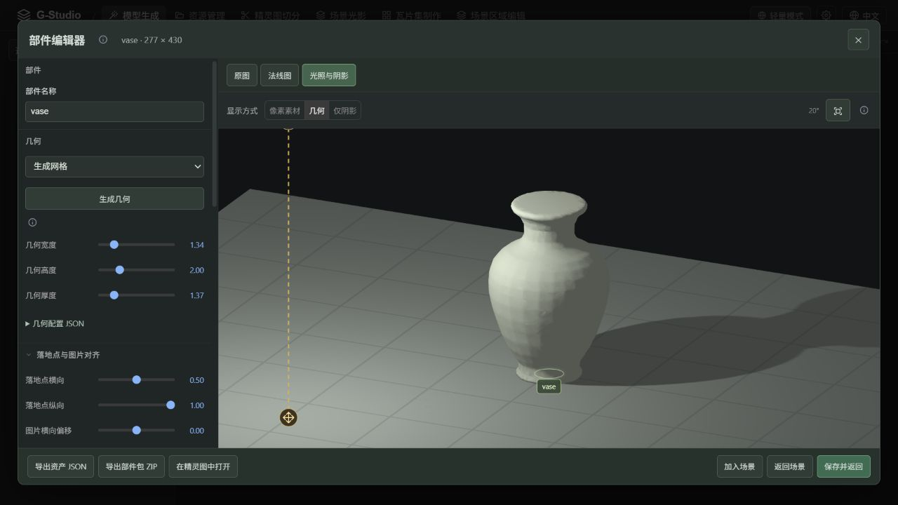
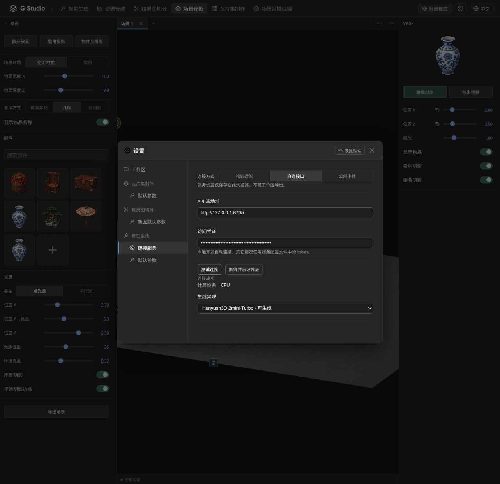

# 模型生成服务验证记录

历史实测：2026-10-26 至 2026-10-28。结果只适用于下列环境与当时版本；当前操作见[后端部署](../../services/generation-python/README.md)，测试入口见[开发指南](../../CONTRIBUTING.md)。

维护说明（2026-10-28）：旧离线打包功能、命令及暂停的打包 stash 已移除。下方涉及旧包的内容仅保留为历史实测证据；当前使用源码与镜像启动，已准备的运行资源仍支持 `--offline`。本地遗留的归档文件不属于当前启动流程。

移除后的回归：19 项 Node 检查通过；复用已有资源执行 `sh start-generation.sh --offline --cpu`，约 34.22 秒达到模型 `ready`，API 确认后端为 CPU，随后停止测试服务。此检查未重复下载或再次执行模型推理。

## 2026-10-28：CPU 从零启动到模型生成

基于合并后的 `b11988f`，在 Windows 11 / i5-10500 / 32 GB 内存上，以国内镜像预设执行 `sh start-generation.sh --cpu`。使用独立的源码副本和全空运行目录，隐藏系统 Node、Python、uv，并隔离旧用户缓存；没有复制现有解释器或模型权重，原项目密钥和缓存保持不变。Hunyuan 推理代码来自仓库自带的已校验 source wheel。

首次验证发现依赖解析总时限过短：`uv` 还在准备本地 PyTorch wheel 时，60 秒时限就中断了进程，换源也重复失败。独立冷缓存诊断用时 107.17 秒后成功。本次将该总时限调整为 300 秒，保留校验和换源机制；随后在另一个全空目录重新验证，解析用时约 115 秒，一次启动通过。

| 项目 | 实测结果 |
| --- | --- |
| 首次环境及权重准备 | 2617.72 秒，约 43 分 38 秒；包含网络下载、安装与校验 |
| 服务端模型生成 | 303.78 秒 |
| API 提交至完成（含轮询） | 305.81 秒，约 5 分 6 秒 |
| 全程 | 2923.59 秒，约 48 分 44 秒 |
| 参数 | 花瓶样例；5 步、256 分辨率、seed=12345、目标 12,000 面 |
| 实际计算后端 | CPU，Python 3.12.12 / PyTorch 2.6.0+cpu，4 线程 |
| 输出 | 12,000 面、6,006 顶点；GLB 289,164 字节，摘要与接口声明一致 |

图像编码、采样、网格阶段日志分别约 122.73、142.78、31.35 秒。四视图可辨认花瓶外形，但瓶口封闭，watertight 检查为 false；流程通过不等同于精确还原或完整拓扑验收。首次准备时间主要受本次下载和磁盘环境影响，不是缓存启动耗时，也不是跨平台性能排名。

18 项 Node 测试、22 项 Python 测试通过，修复后重跑的 11 项相关 Node 回归测试通过。测试服务已停止，工作缓存保留。此前暂停的资源包改动独立保存在 Git stash，未混入这次验证，也未重打离线包。

[精简实测数据](./model-generation-cpu-fresh-20261028.json) 随文档保存。本地日志、模型和四视图位于 `output/fresh-cpu-20261028-fixed/`；从零复现入口为 `tests/generation_fresh_e2e.py`。

## 2026-10-27：设备实测汇总

当前分发范围为 CPU、NVIDIA CUDA、Apple Silicon MPS。不推荐普通 Windows 核显用于本项目的 GPU 推理；这不是对全部核显性能的结论，也不适用于已通过测试的 Apple MPS 路径。

| 设备 / 路径 | 编码 | 采样 | 网格 | 结果 |
| --- | ---: | ---: | ---: | --- |
| i5-10500，32 GB，CPU 4 线程 | 114.7 秒 | 54.1 秒 | 58.9 秒 | 成功，阶段合计 227.7 秒 |
| 同机 UHD 630，DirectML | 489.1 秒 | 217.4 秒 | 162.0 秒 | 成功阶段合计 868.4 秒，是 CPU 的 3.81 倍 |
| Radeon 780M 笔记本 | — | — | — | 小算子通过，实际模型推理报错，未取得有效总耗时 |
| Apple M5，24 GB，macOS 26.5.2，MPS | — | — | — | 完整离线包启动和正式 API 通过；5 步、256 分辨率生成 84.5 秒，外形检查通过，无 CPU 回退 |
| NVIDIA CUDA | — | — | — | 环境/包已准备，完整 GPU 推理未验证；MX150 2 GB 使用 CPU |

Intel/CPU 对照使用 Hunyuan3D-2mini-Turbo、花瓶图片、1 步、128 分辨率、seed=12345、Torch 2.4.1 和 vanilla 网格解码。CPU 为原生 FP32；GPU 为 DirectML FP16，编码/采样按 128 分块、网格按 512 分块，并同步控制内存。计时包含各阶段进程启动、模型加载和写出。GPU 网格阶段复用了成功编码/采样的缓存，合计不包含失败尝试，也不是一次连续最终配置运行。GLB 仅验证非空和坐标有限，未验证外观质量及两条路径输出等价性。

同规模注意力微基准：CPU 约 0.82 秒，GPU 约 3.47 秒；增加分块到 512 或减少同步并未提速。原生 GPU 路径失败时物理可用内存从 15.50 GiB 降至 2.28 GiB，系统提交余量仅 0.714 GiB，而新申请约 1.27 GiB；分块后可完成计算。因此不能仅凭任务管理器的共享 GPU 内存上限判断可运行性，也不能认定核显一律不能运行。

Mac 使用完整离线包，经 `sh start-generation.sh --offline --mps` 启动并通过正式 HTTP API 生成花瓶。参数为 5 步、256 分辨率、seed=12345、目标 12,000 面；服务端生成 84.45 秒，包含提交与轮询 86.52 秒，输出 11,999 面。实际后端为 MPS，没有 CPU 回退；花瓶轮廓正常，瓶口与此前 CPU 结果一样封闭。默认参数下的历史 CPU 花瓶记录为 429.27 秒，这不是严格的跨平台性能基准；其他 Mac 仍待验证。

在同一 Mac、同一完整服务和 256 分辨率下，仅将采样改为 1 步，结果再次严重变形，并耗时约 201.96 秒。此前独立测试的 1 步、128 分辨率、约 99 秒结果只证明流程执行成功，不能作为外形质量通过的依据。历史 CPU 正式 HTTP 流程约 211 秒同样使用简化参数、Torch 2.6 和 FlashVDM，与本节 vanilla 对照不是同一配置。

[精简数据记录](./model-generation-benchmarks-20261027.json) 随文档保留。原始日志、预览、运行环境和分发包属于本地测试材料，不纳入 Git；生成成功还需结合外形检查判断。

推荐使用 CPU、经兼容性检测的 NVIDIA CUDA 或 Apple MPS；Windows 核显使用 CPU。GPU 选择应结合实际模型可运行性、结果有效性和耗时，而非仅看设备名称。当前尚未实现按实测耗时自动择优。

## 2026-10-27：国内 uv 引导与三种离线包

本节记录在下方缓存迁移验证之后完成的更新：

- uv 0.9.7 优先从清华 PyPI 镜像取得对应平台的官方 wheel，按官方 PyPI SHA256 和大小校验后提取原生程序；失败时使用 GitHub 发布包。Windows 镜像实下载约 13 秒完成，程序版本检查通过；备用源切换有自动测试覆盖。
- 生成 Windows x64 CPU、Windows x64 CUDA 12.4、Mac ARM64 MPS 三个完整 ZIP64 后端包，分别约 6.18GB、9.68GB、5.29GB。每个包均包含 Node、uv、独立 Python、完整模型依赖、权重和推理源码，不包含私有凭证或历史任务。
- 三个最终包均通过全部文件 CRC 检查，包内启动/后端源码与当前工作区一致；分别检查了 24,085、24,124、23,410 个资源文件。离线包被 Git 忽略，仅 `runtime/README.md` 纳入源码管理范围。
- Windows CPU 和 CUDA 环境均通过依赖导入检查及离线依赖一致性检查。CUDA 包在本机 Intel UHD 630 上明确选择 CPU，未宣称 Intel GPU 加速。CPU 的真实推理与搬移验证见下一节；本机没有 NVIDIA 显卡，未验证 CUDA 加速推理。
- Mac 包使用官方 ARM64 Python/Node/PyTorch 和对应平台 wheels，经过原生文件架构、依赖版本和 wheel 平台标签检查，面向 macOS 14+。构建时仅做静态检查，包元数据保留 `cross-platform-static`；后续 Apple M5 已通过完整包启动、API 推理和外形检查，见上方实测汇总。交叉构建本身不会自动认证其他 Mac。
- Intel XPU、AMD ROCm 不标为支持。设备探测区分 CUDA 与 HIP，并检查实际设备运算。NVIDIA/MPS 离线包显式使用 `--cpu` 时复用包内环境，不要求另下 CPU 包。
- 8 项 Node 引导/镜像测试、13 项 Python 运行时测试、打包白名单测试、3 组 HTTP/中转集成测试通过；前端构建、中转类型检查和 4 项生成协议测试通过。GPU 成功与异常分支的模拟测试仅证明选择/回退逻辑。

## 2026-10-27：项目内缓存与可分发后端

运行资源统一到 `runtime/generation/`，私有数据独立到 `runtime/generation-data/`。根目录实验文件已退出源码；所需权重和推理源码先迁入正式缓存，其余本地历史文件归档到不提交 Git 的 `runtime/archives/`。前端仍使用的 `src/modules/experiments/` 数学与几何模块保留。

Windows x64 CPU 验证：

- 从已验证的旧环境导入 Python 本体和完整依赖，不再依赖旧 venv 的绝对解释器路径；两份权重按正式清单校验。
- 通过 sh 生成约 6.1GB 的 ZIP64 后端包，包含 Node、Python、依赖、模型和源码。打包白名单排除凭证、任务数据、下载缓存和其他平台。
- 换到带空格的短目录解压，隐藏系统 Node/Python/uv 的 PATH，使用 `GEN_OFFLINE=1` 经同一个 sh 入口启动。解释器路径位于解压目录，未引用原用户的 Python 路径。
- 使用解压后的正式 HTTP 接口完成真实 Hunyuan 花瓶推理：steps=1、resolution=128、seed=12345、目标 1,000 面，耗时约 211 秒，输出 GLB 129,916 字节且摘要一致。这是可搬移运行验证，不是与此前默认参数耗时的同条件比较。
- 在另一套空的轻量运行环境中，自动下载 uv、Python 3.12.12 并安装 14 个依赖；移入统一缓存后，以离线模式再次准备，直接通过且不下载。
- 下载器测试覆盖缓存命中时零请求、续传、摘要错误、源无响应超时；打包测试检查敏感配置和其他平台被排除。8 项 Python 运行时测试、3 组真实 HTTP/中转集成测试通过，前端构建、中转类型检查与 28 项场景测试通过。

Windows 的深层嵌套解压路径触发过旧 ZIP 路径长度限制，使用短目录验证通过；启动路径可以包含空格。建议接收者解压到如 `E:\GStudio` 的位置。Mac ARM64、Linux 和 CUDA 包需要在对应平台验证；此次没有增加 MPS，也没有把 Windows 验证视为跨平台实测。

## 2026-10-26：正式生成服务

生成服务、两种连接方式、设置菜单、生成工作页和标准部件网格接入已经实现。验证在 Windows x64、Intel Core i5-10500、32GB 内存、Intel UHD 630 上完成。

## 实际生成与资产流程

以下结果均由正式生成接口调用 Hunyuan3D-2mini-Turbo 得到，没有使用模板或轮廓算法代替 AI 输出。采样 5 步、seed 12345、网格分辨率 256、目标 12,000 面；耗时包含分阶段模型加载、推理和减面，不含首次下载。

| 输入 | 路径 | 完整任务耗时 | 输出三角面 |
| --- | --- | ---: | ---: |
| 油纸伞 | HTTP 生成接口 | 354.19 秒 | 11,999 |
| 花瓶 | 浏览器上传并提交、轮询、下载 | 429.27 秒 | 12,000 |
| 椅子 | 一键引导新建的 Python 环境，经 HTTP 接口生成 | 467.22 秒 | 12,000 |

椅子使用自动下载的 Python 3.12.12、PyTorch 2.6.0+cpu 和锁定依赖，未调用实验目录中的 Python 运行时。模型文件从本机已有的已验证副本复用，再按正式清单校验。环境安装、实际推理和模型文件校验分别验证；本次没有为了测试重新从互联网下载另一份 4.2GB 权重。

在浏览器中验证了花瓶结果刷新后恢复、预览、应用到标准部件、进入部件编辑器、加入场景，以及停掉 Python 服务后刷新场景仍可显示网格和阴影。GLB 作为 v2 部件的一部分持久保存；旧 v1 部件仍可使用。模型输出仍可能封闭瓶口或填充椅子空隙，生成成功不等于几何语义正确。

## 设备识别与设置

启动日志识别到 Intel UHD 630，并明确报告 CUDA 不可用和最终选择 CPU。前端连接后通过基本信息接口显示“计算设备：CPU”。GPU 是代码中的默认优先路径；本机无 NVIDIA 显卡，真实 CUDA 推理尚未验证。GPU 成功、初始化失败回退和强制 CPU 的单元测试使用模拟运行时，仅验证选择逻辑。

## 启动和协议验证

- 在空目录中自动下载 uv、安装 Python 3.12、创建隔离环境并安装依赖；随后完成真实模型推理。
- `npm run dev` 同时启动网页和 Python，两端健康访问成功；发送 Ctrl+C 后两个测试监听端口均释放。
- 下载器验证断点续传、SHA256、损坏文件重新下载和已有正确文件复用；下载锁由操作系统管理，退出后自动释放。
- HTTP 测试覆盖凭证、Origin 拒绝、CPU 基本信息、重复提交返回同一任务、相同 ID 不同请求拒绝、非法参数、错误图片格式、摘要不符及幂等取消。
- HTTPS/WSS 测试使用临时证书及独立信任配置，没有禁用证书验证。覆盖 8 位码、本地终端确认、浏览器授权、结果传输和哈希校验、错误凭证拒绝、解绑后授权失效。
- 中转进程重启后设备自动重连，原授权和任务仍可查询，重复提交仍返回原任务。执行端遗留的未完成任务在重启后明确标记为中断，不会静默重复计算。

## 自动检查

| 检查 | 结果 |
| --- | --- |
| `npm run build` | Vue/TS 检查和生产构建通过；不触发模型下载 |
| `npm run check:relay` | 中转 TS 检查通过 |
| `npm run test:parts` | 21 项通过 |
| `npm run test:scene-lighting` | 19 项通过 |
| `npm run test:generation` | 4 项通过，包含第三方能力响应和 GLB 边界验证 |
| `tests/generation_runtime_test.py` | 4 项通过 |
| `tests/generation_service_test.py` | 3 组端到端测试通过，包含 TLS 中转与重启 |

复现 TLS 测试时设置 `GENERATION_TEST_TLS=1`，使用服务的隔离 Python 执行测试；OpenSSL 可使用 Git for Windows 附带版本。测试自行创建临时服务和数据，不操作用户工作区。

用实际椅子网格重复准备 24 个实例，得到 287,400 个有效渲染三角面，CPU 几何准备约 1.48 秒且全部顶点有限。这不是 GPU 帧率基准；大量不同模型、多光源和低端浏览器仍应按实际场景调节面数预算。

## 验证范围

已验证 Windows CPU、Apple M5 的完整离线包启动和 MPS API 推理、本机 HTTP、带证书校验的本机 HTTPS/WSS，以及浏览器资产流程。NVIDIA GPU 完整推理尚未通过实机验证；Linux、其他 Mac、真实公网反向代理和公网网页到 localhost 的浏览器授权兼容性尚未在对应环境验证。
