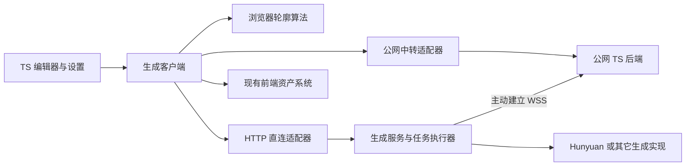

# 模型生成服务接入方案

版本：v1，2026 年 10 月 26 日。状态：服务、启动脚本、中转与前端已接入；Windows CPU 和本机 TLS 中转已验证，NVIDIA GPU、Linux 及实际公网部署仍需对应环境验收。

G-Studio 保留 TS 前端和现有资产管理，引入可替换的几何生成协议。首个服务实现采用 Python 和 Hunyuan3D-2mini-Turbo，同时支持用户浏览器直连服务、Python 主动连接公网中转服务两种方式。未配置生成服务时，继续使用浏览器内的轮廓近似算法。

本方案覆盖开发启动、模型下载、接口、设备配对、设置 UI、部件接入与验收。可执行命令见根目录 README，实际接口见 `packages/generation-protocol/`。实现中使用设备级浏览器授权、嵌入 GLB 的部件 v2 和可过期的任务存储；不要求先建立账号或云资产库。

## 一 已确定的产品边界

| 项目 | 决定 |
| --- | --- |
| 开源用户启动 | 根目录 `npm install` 后执行 `npm run dev`；自动准备 Python 环境、启动服务和下载默认模型 |
| Python 默认行为 | 随开发命令启动；模型准备在后台进行，不阻塞网页启动 |
| 计算设备默认行为 | 优先检测并启用可用 GPU；没有兼容 GPU 或初始化失败时回退 CPU，日志明确说明原因 |
| 设备信息展示 | 服务提供基本信息接口，首期仅返回 `deviceType: "cpu" / "gpu"`；前端连接成功后显示实际选用类别 |
| 无配置默认行为 | 使用轮廓近似；服务启动不等于自动启用 AI，也不自动上传图片 |
| 服务职责 | 接受生成任务，返回几何和必要元数据；不管理项目、部件、场景或用户资产库 |
| 可替换性 | 协议独立于语言与模型，可实现为其它 AI、纯算法或远程服务 |
| 连接方式 | HTTP 本地直连，或 Python 向公网 TS 后端建立 WSS 中转连接 |
| 首个模型 | Hunyuan3D-2mini-Turbo，仅生成几何，不做纹理生成 |
| 前端入口 | 设置中新增“模型生成”，另提供模型生成工作页与部件内生成按钮 |
| 应用结果 | 先预览和对齐，再由用户应用；服务失败不覆盖原有模型 |

不在首期范围：训练模型、自动修补语义错误、从任意网格恢复可编辑基础形体、运行用户上传代码、公共算力共享市场。

## 二 当前基础与接入前提

根目录 `package.json` 的 `dev` 现在由跨平台 Node 启动器编排 Vite 与 Python；`dev:web` 保留单独启动网页的方式。TS 中转后端独立于推理服务启动。

设置入口为 `src/shared/components/SettingsDialog.vue`，复用 `SegmentedControl`、`InlineSwitch`、`SvgIcon` 等组件。`src/shared/settings/settings-store.ts` 会把设置写入工作区配置；设备凭证不能直接放进这个对象。

场景光照和标准部件沿用已有工作分支中提交的实现，复用资产版本、撤销和渲染流程。新增 `mesh` 几何及部件格式 v2；旧 v1 部件仍可读取。

本地 Hunyuan 验证使用 i5-10500、32GB 内存、4 个 CPU 线程，三张样例完整生成约 6～8 分钟，最高阶段进程工作集约 7.24GB。该值不是整机最低内存保证，GPU 速度尚未在本次实验验证。伞体明显改善，但花瓶封口和椅子空隙被填的问题仍存在。详见[实测报告](../experiments/hunyuan3d-local/VALIDATION.md)。

## 三 分层与职责



| 层 | 职责 | 不承担的职责 |
| --- | --- | --- |
| 前端生成客户端 | 统一提交、状态、取消、结果获取，屏蔽传输差异 | 模型推理和模型下载 |
| 浏览器算法 | 无服务时直接生成近似几何，使用同一逻辑结果结构 | 网络连接 |
| Python 服务 | 校验请求、临时任务队列、调用生成实现、返回结果 | 资产目录、资产版本、场景编辑 |
| 生成实现 Provider | 准备依赖、描述能力、推理或算法生成、取消和清理 | HTTP、WSS、账号和 UI |
| 公网 TS 后端 | 设备绑定、鉴权、转发、任务记录和临时文件传输 | 加载 Hunyuan、长期保存用户资产 |
| 前端资产系统 | 保存模型二进制、版本、场景引用、导入导出和撤销 | 调度模型计算 |

Python 可以保留运行所需的模型缓存、阶段缓存和短期任务文件。这些是可过期的运行数据，不构成资产库。只有前端确认接收并保存的结果才是用户资产。

生成实现的核心抽象包含 `describe`、`prepare`、`generate`、`cancel`；返回能力、生成结果与结构化进度。CPU 分阶段加载属于 Hunyuan 实现内部细节，不进入通用协议。

## 四 一键启动和模型准备

### 用户使用的命令

实施后的 README 首屏快速开始应使用以下路径，并同时维护中文与英文说明：

```bash
git clone https://github.com/huzz-open/g-studio.git
cd g-studio
npm install
npm run dev
```

前置要求收敛为 Git、兼容版本的 Node.js 与 npm，以及首次下载所需网络。当前 Vite 8 要求 Node `^20.19.0 || >=22.12.0`，快速开始统一建议 Node 22.12 或更高兼容版本；不能继续写 Node 18。

启动器自动获取固定版本的运行时管理工具和 Python 3.12，创建项目隔离环境并按锁文件安装依赖，不要求用户手动安装 Python、激活虚拟环境或执行 pip。采用受校验的 uv 引导程序；系统已有兼容工具时可复用，但不得修改全局 Python 依赖。

| 目标命令 | 行为 |
| --- | --- |
| `npm run dev` | 同时启动 Vite 和本地 Python 服务；缺失默认模型时自动后台下载 |
| `npm run dev:web` | 仅启动网页，不准备 Python 和模型，适合只用轮廓算法或远程服务 |
| `npm run generation:start` | 单独启动生成服务，适合用户只使用已部署的公网网页 |
| `npm run generation:download` | 提前下载并校验当前配置的模型，便于之后离线启动 |
| `npm run generation:doctor` | 检查环境、磁盘、模型文件、端口和连接状态 |
| `npm run relay:dev` | 单独启动 TS 中转后端，用于联调；不隐含启动推理 |

模型下载和 Python 安装不放在 `npm install` 的隐式安装钩子里。第一次执行默认开发启动时明确显示下载目标、容量、阶段和错误恢复办法。后续提供 Windows 双击启动器与其他平台脚本作为同一 Node 启动器的薄封装。

### 启动顺序

1. 启动 Vite，让基础编辑功能立即可用。
2. 检测 GPU 与驱动，准备兼容的隔离 Python 环境；缺失时自动建立，终端显示准备进度。在该环境中完成运行时检测，默认优先选择可用 GPU。
3. 启动轻量服务外壳，健康接口可用；重型库加载和下载在独立工作进程进行。
4. 后台准备默认 Hunyuan 权重。设置显示“环境准备中”“下载模型”“校验模型”或“可生成”，不能把进程启动当成模型就绪。
5. 模型准备完成后按任务加载；空闲时不必常驻数 GB 推理内存。

首次需要约 4.2GB 权重，另外还需 Python、PyTorch、依赖、临时下载及任务空间。启动器根据实际清单检查空间并报告缺口。默认优先 GPU，CPU 作为无兼容 GPU 时的可用路径；启动器自动准备匹配的推理依赖，不要求所有用户手动安装 CUDA 开发工具包，也不自动改动系统显卡驱动。

### GPU 优先与启动日志

先识别硬件与驱动，再选择兼容的 PyTorch 依赖并在实际运行环境中验证设备可用性。不能只调用 CPU 版 PyTorch 得到“无 CUDA”就认定机器没有 GPU。运行时验证至少包括设备枚举、兼容性检查和小规模设备运算；模型加载仍可能因显存不足失败。

首期 GPU 支持以 NVIDIA CUDA 为目标，必须加入发布验收。检测到 Intel、AMD 或 Apple GPU 时也记录其类别，但未适配的后端不能标记为可用；明确记录“不支持此 GPU 后端，使用 CPU”。有 GPU 不等于模型可以使用它。

服务启动日志必须包含：检测到的 CPU/GPU 类别、GPU 厂商与型号（可获取时）、运行时检查结果、最终选用的 `CPU` 或 `GPU`，以及回退原因。初始化期间显示“设备检测中”，不能提前打印“GPU 已启用”。示例为日志格式约定，不代表当前机器配置：

```text
[generation] detected: CPU; GPU vendor=NVIDIA, model=<检测到的型号>
[generation] runtime: CUDA available, device validation passed
[generation] selected device: GPU
```

```text
[generation] detected: CPU; GPU vendor=Intel, model=<检测到的型号>
[generation] fallback: GPU backend unsupported by this provider
[generation] selected device: CPU
```

默认策略为 `gpu-preferred`，无兼容 GPU、运行时初始化失败或显存不足时，释放 GPU 资源并检查 CPU 可运行条件；可以回退则更新日志与基本信息接口，不满足 CPU 条件则报告失败。单个任务最多进行一次可恢复的 GPU 到 CPU 重试，沿用同一任务 ID，不能无限重试或把所有异常都当成 GPU 故障。服务端可提供显式 CPU 配置覆盖用于诊断，前端首期只展示类别，不新增计算设备控制字段。

网页已启动但 Python 准备失败时，保留网页和轮廓功能，显示可重试错误，不宣称完整启动成功。模型下载失败可恢复；切换服务模式不删除已下载模型。用户可通过 `dev:web` 明确跳过全部服务准备。

开发进程由跨平台 Node 启动器管理；Ctrl+C 清理本次启动的子进程，不能结束其他任务的 Python。端口冲突时识别兼容实例，否则明确提示；不静默连接未知进程。启动器创建一次性开发配对信息供 Vite 的仅本机开发桥使用，不把长令牌编入 JS、写入 URL 或公开 Vite 环境变量。

### 下载与开源发布

- 模型清单固定来源、版本、文件大小、SHA256、许可证和 Notice。优先上游官方来源；备用镜像必须对应同一版本和校验值。
- 下载到临时文件，支持断点续传，校验成功后原子替换；并发启动通过锁避免重复下载。损坏文件重新获取，不能静默使用。
- 缓存和配置目录允许通过环境变量覆盖；默认放入用户应用数据或缓存目录，并支持含空格和中文的路径。
- 按 Provider 准备依赖；算法实现不需要下载 Hunyuan。仅后台任务需要图形处理，服务器不依赖桌面窗口。
- 环境、权重、任务文件和凭证不提交 Git。依赖版本、下载脚本、协议和模型清单纳入版本控制。
- README 区分项目许可证、上游代码许可证与模型使用条款，保留来源链接和 Notice，不把权重描述成自动继承项目许可证。若上游要求用户单独接受条款，启动器明确报告并支持用户提供已有文件，不绕过要求。
- 首期验收覆盖 Windows x64、Linux x64 的 CPU 路径，以及 NVIDIA CUDA GPU 自动选用路径；GPU 是默认优先路径，必须实测通过后发布。macOS、其它 GPU 后端和未验证组合不标注已支持。一键启动不代表所有平台都已适配。

## 五 生成协议 v1

协议名为 `g-studio/generation`，主版本为 `1`。以 OpenAPI 和 JSON Schema 定义请求、能力、任务与结果，生成或校验 TS 类型和 Python 数据模型。第三方可以使用任意语言实现 HTTP 协议；无需依赖 G-Studio 的资产内部结构。

### 能力与请求

能力接口列出 `providerId`、显示名称、实现版本、模型修订、可用状态、输入 MIME/尺寸/字节上限、输出格式、并发数、取消能力与参数范围。参数分通用项和 Provider 专属项；不支持的参数明确拒绝，不能悄悄忽略。前端只显示服务宣告支持的选项，不把 Hunyuan 的采样步骤写死为通用设置。

首期任务类型为 `image-to-geometry`，输入为一张图片及结构化参数。请求带 `protocolVersion`、`clientRequestId`、`providerId`、图片 SHA256、可选 seed、目标面数及 Provider 参数。图片以文件上传，不接受任意磁盘路径、任意远程 URL 或可执行代码。

PNG 透明背景为首选；其它格式仅在能力中明确支持时开放。裁剪与去背景由前端预处理或 Provider 明确宣告的能力完成，结果记录实际输入摘要和处理方式。请求不传整个工作区、聊天记录或无关资产。

### HTTP 接口

基地址示例为 `http://127.0.0.1:8765`；生产远程接口必须使用 HTTPS。

| 接口 | 约定 |
| --- | --- |
| `GET /health` | 最小存活信息，不泄露设备路径与凭证 |
| `GET /v1/info` | 需认证；返回当前生成执行端实际选用的设备类别，首期成功响应只有 `deviceType` 一个字段 |
| `GET /v1/capabilities` | 协议版本、Provider 和模型准备状态，需认证 |
| `POST /v1/jobs` | multipart 图片和 JSON 请求；返回 202、任务 ID 和查询路径 |
| `GET /v1/jobs/{id}` | 当前状态、阶段、结果描述或结构化错误 |
| `POST /v1/jobs/{id}/cancel` | 幂等取消；区分已接受取消与已经停止 |
| `GET /v1/jobs/{id}/outputs/{outputId}` | 获取本任务的临时结果，需鉴权，支持有限期重试下载 |
| `POST /v1/jobs/{id}/ack` | 客户端确认已经持久保存，允许提前清理临时输出 |

基本信息接口成功响应示例：

```json
{ "deviceType": "gpu" }
```

`deviceType` 只能为 `cpu` 或 `gpu`，分别在前端显示为“CPU”和“GPU”。它表示当前 Provider 经过运行时验证、实际选用的主要推理设备类别，不是机器上是否装有显卡，也不承诺预处理和导出全部在 GPU 上运行。未来多个 Provider 可通过 `providerId` 查询参数指定目标，成功响应仍只保留这一个字段；首期省略参数即查询默认 Provider。

模型下载是否完成继续由能力接口表示。设备尚未确定时，信息接口返回 503 和已有结构化错误 `DEVICE_NOT_READY`，不得编造 CPU/GPU；前端显示“设备检测中”。切换 Provider、GPU 回退 CPU 或设备重连后需重新获取信息。旧服务不支持该接口时显示“设备类型未知”，不根据地址或服务名称推断。

相同调用方、相同 `clientRequestId` 和相同请求摘要返回同一任务；同 ID 不同内容返回 409。v1 保证 24 小时幂等记录，过期后返回明确过期信息，客户端不得因一次超时自动换 ID 重复生成。

主要状态为 `queued → running → succeeded / failed`；取消经过 `cancel_requested → cancelled`。进度包含阶段、阶段内已完成量和总量（可为空），未知总量显示不定进度，不能伪造整体百分比。服务准备状态与任务状态分离，尚未准备好的 Provider 返回 `PROVIDER_NOT_READY`。

结果临时文件到期后标记为 `expired`；任务失败包含 `code`、用户可读信息、`retryable` 和请求关联 ID。常见错误区分参数不支持、输入超限、未授权、设备离线、资源不足、模型未就绪、执行失败和结果过期；HTTP 使用相应的 4xx/5xx，不一律返回 200。

默认每台 CPU 设备并发 1，等待队列上限 8。初始上传限制为 10MiB、最大 2048×2048，解码后也检查尺寸；输出上限暂定 128MiB，通过能力接口公布。这些是协议运行限制，不是模型效果指标。超限拒绝，不能耗尽整机资源后才报错。

### 结果约定

首期互通格式统一为自包含 GLB 2.0 和 JSON manifest，禁止外部纹理或缓冲区引用。算法实现也可输出同一格式；浏览器轮廓实现可以直接交付等价内存网格，避免为本地算法强制引入网络。

manifest 至少包含以下内容：

- 协议版本、任务 ID、输入摘要、Provider/模型/实现修订、实际参数和耗时。
- 输出 ID、用途、MIME、字节数、SHA256、三角面数、包围盒、结果到期时间。
- 坐标系、轴向、归一化变换、pivot、模型局部朝向；不从单图声称真实物理尺寸。
- 数值检查结果、是否做过减面等后处理，以及模型生成警告。

通用几何约定为右手系、Y 向上、地面 Y=0、水平居中、最长边归一化为 2。模型朝向及参考相机信息必须显式记录，单图无法可靠估计的相机参数保留未知，由用户在预览中对齐。已有实验评审输出采用 Z 向上，接入时必须转换并验证，不能直接当作相同坐标系。

必须提供可预览/投影的 `shadow` 输出；可选提供高精度 `source` 输出。目标面数为预算请求，返回实际面数与警告，不把本次实验的 4 万面当成固定生产标准。输出验证拒绝非有限坐标、损坏索引和超预算文件；不要求所有形体封闭，也不自动补洞改变语义。

### 临时数据生命周期

输入和输出默认保留至任务结束后 24 小时，ack 后可提前清理，异常退出由下次启动清理过期文件。轻量任务元数据保留至少覆盖幂等窗口；模型缓存独立管理，不随任务删除。前端只有在持久保存成功后才 ack；暂存 URL 不能成为资产永久引用。

## 六 两种连接模式

### HTTP 直连

开发时默认 Python 只监听 loopback。网页配置服务基地址、访问凭证并测试连接，按能力选择 Provider；进度先使用 1～2 秒轮询，页面后台时降低频率。不依赖长 HTTP 请求等待完整推理。

服务验证 Origin、Host 和凭证；CORS 白名单只允许指定站点。公网 HTTPS 页面连接本地服务仍需要浏览器本地网络访问授权及兼容验证，不能要求关闭浏览器安全机制。参见 [Chrome 本地网络访问说明](https://developer.chrome.com/blog/local-network-access)。不支持时提供中转模式，或本地启动网页后使用。

本地 WS/WSS 不作为首期必需能力。WSS 还要求浏览器信任证书，不能把自签名证书视为自动可用。远程 HTTPS 直连沿用同一 API，不通过公网后端代理用户任意填写的 URL。

### WSS 公网中转

Python 主动连接配置的中转地址，例如 `wss://example.com/generation/worker`。公网只需部署轻量 TS 后端和 HTTPS/WSS 反向代理，不需要 GPU，不需要运行 Python 推理。生产部署不能只有静态文件托管；静态站点可另外配置中转服务地址。

网页与中转后端交换同一任务数据结构；中转把逻辑调用路由至已授权设备。WSS 消息使用版本、消息 ID、任务 ID、尝试编号、事件序号和消息类型封装，支持认证、能力、心跳、派发、接收确认、进度、取消和结果通知。

中转提供 `GET /v1/devices/{deviceId}/info`，校验当前用户对该设备的访问权限后，经 WSS 请求对应执行端的基本信息；成功响应同样只有 `deviceType`。必须返回用户本机生成服务的设备类别，不能返回公网中转服务器的 CPU 类别。设备离线或查询超时按明确错误返回，前端标记不可用，不把旧缓存当作当前在线结果。

图片与 GLB 通过任务限定的 HTTPS 临时文件端点传输，不在 WSS 控制消息中塞大段 base64。Python 只下载已认证中转所分配的任务文件；校验来源、大小和摘要，不接受任意地址或重定向。公网服务器能接触中转图片与模型，UI 和 README 必须说明其临时保留时间；这不是端到端加密方案。

建议心跳 20 秒、60 秒无响应标记离线，重连指数退避并带随机抖动，上限 30 秒。任务接受和完成需确认；相同任务不得重复开始。断线时本地已接受任务继续执行，重连用任务 ID、尝试编号和最新序号对账。服务端不得仅因设备短暂离线就重新派发正在执行的任务。

Python 重启后只有完整可验证的阶段缓存可恢复，否则报告中断；不承诺任意阶段无损续跑。取消与完成竞态由服务端原子状态转换决定，重复消息不改变已经确定的终态。前端刷新按原任务 ID 恢复观察。

首期中转以单实例 TS 服务、持久化设备/任务元数据和有配额的临时文件目录实现。重启后设备重连、任务对账；以后扩展多实例时再引入共享队列和连接路由。公网服务不接受远程任意命令，也不提供通用内网隧道。

## 七 配对码与设备权限

8 位字母数字用于人工配对，长期认证使用独立的高强度随机凭证。短码与长期凭证不能共用。

1. Python 启动读取本机配置；没有设备凭证时安全随机生成 32 字节秘密，并通过 TLS 注册设备身份。后续使用服务端签发、可撤销的设备令牌自动重连。
2. 用户开启配对后，Python 使用安全随机数生成 8 位字母数字码，在已认证连接上注册；中转检查当前有效码唯一性，冲突时重新生成。
3. 配对码有效期默认 5 分钟、成功一次即失效。支持本地输入或配置指定本次配对码，但仍受相同有效期和冲突检查约束，不能永久复用或每次启动静默重开配对。
4. 网页输入短码发起请求，本地终端或启动器确认本次请求；两端显示匹配的请求标识。已绑定设备正常使用时不反复确认。
5. 绑定完成后网页获得限定设备的会话权限；Python 长期令牌不交给网页。单个配对码连续 5 次失败作废，同时限制来源和全局尝试速率。

借鉴短码和长期设备凭证分离的设计，而非宣称本方案已实现完整 OAuth 设备流程。短码限流依据见 [RFC 8628](https://www.rfc-editor.org/rfc/rfc8628.html#section-5.1)。

无账号版本先绑定浏览器会话。实现采用配对完成后签发的设备限定 Bearer 授权，保存在设备级浏览器存储中，以支持静态站点和独立中转域名；不依赖第三方 Cookie。此授权可撤销、30 天到期，丢失后需重新配对。未来若使用同源账号服务，可迁移到 Secure、HttpOnly、SameSite Cookie。当前仍校验 Origin，工作区导出不含授权，多浏览器访问不自动开放。

每次提交、查询、取消和下载都验证设备与任务归属；解绑或撤销立即停止接受新任务并撤销相应会话，已运行任务按明确策略取消。不能靠不可猜的任务 ID 代替授权。WebSocket 的操作级鉴权参见 [OWASP 指南](https://cheatsheetseries.owasp.org/cheatsheets/WebSocket_Security_Cheat_Sheet.html)。

提供本地暂停接单、查看当前任务、重新配对和撤销设备凭证入口。凭证不放 URL、普通日志、截图提示或工作区导出中；配置文件限制本机访问权限。直连使用独立凭证，不能复用中转设备令牌。

## 八 设置与生成 UI

### 设置菜单结构

沿用用户截图中的双栏设置弹窗：左侧分类树，右侧紧凑表单，顶部标题、恢复默认与关闭。新增一级“模型生成”，下设“连接服务”和“默认参数”。连接模式采用现有分段控件：`轮廓近似 / 直连接口 / 公网中转`，默认选择轮廓近似。

| 页面 | 内容与行为 |
| --- | --- |
| 连接服务 · 轮廓近似 | 简短说明无需服务；不展示地址和密钥输入框 |
| 连接服务 · 直连接口 | API 基地址、隐藏凭证输入、测试连接、状态、Provider 选择；连接成功后显示“计算设备：CPU/GPU”；默认地址建议 `http://127.0.0.1:8765` |
| 连接服务 · 公网中转 | 中转服务地址、配对码输入、配对操作、已绑定设备列表、在线状态、计算设备 CPU/GPU、重新配对和解绑 |
| 默认参数 | 按 Provider 能力显示质量、目标面数、可选 seed；实现专属参数放入折叠高级区域 |

使用现有图标、分段按钮、输入框、开关、Toast 和颜色体系，不新增独立仪表盘风格、大卡片或浮夸状态动画。对齐当前设置的行间距、标签/说明文字层级、边框、悬停和焦点效果；具体尺寸以实施时的现有组件为准。状态和操作区域可用专用设置子组件，不把异步配对塞进仅支持静态字段的配置表。

用户完成服务配置并连接成功后自动请求基本信息，在连接状态附近增加紧凑的只读“计算设备”行。首期只显示 CPU/GPU，不增加显卡型号、显存、驱动等字段；这些细节留在服务端日志。任务轮询期间低频刷新该信息，重连与任务错误后也刷新，以反映 GPU 回退。信息查询失败不破坏已建立的任务连接，也不阻止旧服务继续使用；显示未知/不可用状态而非错误设备类型。

设置字段延续现有修改/单项恢复规则。连接模式切换影响之后的新任务；任务开始时冻结连接、Provider 和参数，不能中途改投另一台设备。生成默认参数标注“仅影响新任务”。中英文文案一并维护，键盘焦点、Escape、窄屏滚动遵循现有交互。

全局恢复默认恢复生成偏好和连接模式，但不删除资产、模型缓存，也不偷偷撤销设备授权；设备提供明确“解绑/忘记连接”操作。凭证和设备关系与普通工作区设置分开，不能跟随工作区复制或导出。直连凭证保存在设备级浏览器存储，限制访问并可清除；浏览器存储本身不抵御同源脚本被攻破，因此不保存权限更大的设备令牌。

### 生成入口与结果应用

新增“模型生成”工作页，沿用现有模块导航和工作区标签模式，提供输入、任务状态、预览和保存操作；设置只负责连接与默认值。部件编辑器提供“生成几何”操作，直接使用当前图片并共享任务实现。

任务状态区分环境准备、下载、排队、推理阶段、完成、失败、取消和设备离线。暂时断线显示“连接中断，任务状态待确认”，不能立刻显示生成失败或偷偷另建任务。只有用户明确提交时才发送输入图片。

完成后展示模型多角度预览、原图对齐、结果警告、应用与丢弃。应用时检查源部件 ID、revision 和输入摘要；期间部件改变则提示另存或重新确认，不覆盖新修改。保存接入现有资产版本和撤销流程，保留原始像素图片及实例变换。

模型服务不可用时，新建部件继续轮廓近似。用户明确发起的服务生成失败要显示原因，并提供“使用轮廓近似”操作，不把算法结果冒充 AI 成功。已经保存的 AI 网格不依赖服务在线，也不会因设置恢复默认而消失。

## 九 网格与资产接入

现有部件格式新增 `mesh` 几何变体。首期沿用当前部件的自包含资产方式，将 GLB 以 data URI 嵌入 v2 部件，与 SHA256 和生成来源一同保存；JSON/ZIP 和场景导出无需附带服务端地址。旧 v1 部件保持可读，验证器拒绝 v1 中混入网格。以后再按实际资产规模演进为内容寻址的独立二进制引用。

资产保存几何摘要、生成来源、实际参数、轴向和图片对齐信息；绝不保存作为永久依赖的服务端临时 URL。GLB 导入器验证完整结构，再转为现有渲染器可消费的网格；不要求为了投影把整个渲染体系换成另一套引擎。

深度、法线和阴影继续由统一几何与渲染路径计算。检查 Y-up 转换、尺度、pivot、相机以及原图遮罩配准。高精度源模型可选保存，实时阴影优先使用简化版本；面数预算用实际多部件场景测试决定。

用户可放弃不合格结果并继续使用原几何。瓶口封闭、椅子空隙被填等语义错误必须在验收样例中出现，不能用减面、平滑或轮廓指标掩盖。

## 十 开源文档与部署交付

README 中英文版都需要包含以下内容；只有实现并验证后才把目标命令写成已可用能力：

- 最短安装启动命令、首次下载量与缓存位置、再次启动及离线行为。
- `npm run dev` 默认启动 Python 和准备模型，`dev:web` 明确跳过；退出方法和端口冲突处理。
- 仅使用公网网页的用户如何单独启动本地服务，并选择直连或中转。
- 模型来源、校验与条款链接；网络失败、磁盘不足、内存不足和重试方法。
- 支持平台与真实 CPU 测试条件，不宣传未测试的 GPU 性能。
- 默认 GPU 优先的检测与依赖准备规则、CPU 回退原因、启动日志示例，以及设置中的 CPU/GPU 只读展示。
- 纯静态部署、独立远程推理服务、TS 中转部署三个场景的区别。
- 数据路径说明：直连任务图片不经公网中转；中转模式经过服务器且临时保留；最终资产由工作台管理。
- 无配置默认轮廓近似、生成后确认应用以及模型仍可能推断错误。

生产纯静态构建仍只构建网页，不安装 Python、不下载权重。中转后端独立启动；推理服务部署在用户电脑或有算力的机器上。不能让弱公网服务器执行开发用 `npm run dev` 并因此下载模型。

建议目录：`packages/generation-protocol/` 放规范与类型；`src/shared/generation/` 放客户端及适配器；`services/generation-python/` 放服务和 Provider；`services/generation-relay/` 放 TS 中转；`scripts/` 放引导及开发进程管理。实验代码继续保留作为效果基线，正式服务不依赖实验的绝对路径和样例文件名。

## 十一 实施顺序与验收

| 阶段 | 交付 | 通过条件 |
| --- | --- | --- |
| 1 协议和算法实现 | schema、客户端接口、测试用纯算法 Provider、状态机 | 不安装 Hunyuan 也可完成提交、状态、取消和 GLB 结果闭环 |
| 2 一键环境和 Python | 启动器、锁定依赖、模型下载、Hunyuan Provider、直连接口、设备信息接口 | 干净 Windows/Linux 环境按 README 启动；缺失 Python 自动准备；兼容 GPU 默认启用，无兼容 GPU 回退 CPU；日志明确设备类别；下载中网页可用；断点续传和校验生效 |
| 3 设置和部件接入 | 现有风格的设置、工作页、部件操作、网格保存和阴影 | 未配置即轮廓；已有资产可离线重开；修改冲突不覆盖；新旧格式可导入导出 |
| 4 WSS 中转 | TS 后端、设备配对、临时传输、重连对账 | NAT 后设备无端口映射可用；错误会话不能提交、查询、取消或下载他人的任务 |
| 5 发布验证 | 双语 README、平台矩阵、故障指南、基线结果 | 直连和中转使用同一输入产生可追溯结果；弱服务器不执行推理；生产构建不触发模型下载 |

必须覆盖的行为验证：

1. 空缓存启动、已有缓存启动、断网启动、下载中断和错误校验值，均有清晰状态和恢复路径。
2. 未配置、服务离线、模型未就绪、内存不足时保留基础工作流；生成失败不修改原资产。
3. 任务提交超时重试、浏览器刷新、WSS 断线、服务重启、取消与完成竞态，不重复执行或串任务。
4. 8 位码过期、错误次数耗尽、两人竞争配对、设备撤销和越权访问按约定处理；日志与工作区导出不带凭证。
5. 用伞、瓶、椅真实样例检查多视角、空隙、图片配准和两种光源下阴影；测量多个网格同时使用时的耗时与内存，再确定生产面数预算。
6. 依照用户截图复核设置分类、分段控件、标签对齐、状态行、恢复默认、键盘和中英文布局；不另起一套 UI 风格。
7. 分别覆盖可用 NVIDIA GPU、仅 CPU、未适配 GPU、驱动/运行时不匹配、显存不足和检测未完成；启动日志、`deviceType` 与实际执行设备一致。直连和中转配置成功均显示类别，中转不能显示公网服务器的设备；旧接口、离线和超时显示未知或不可用，不误报 CPU/GPU。

完成标准是用户从 README 的最短命令进入可用工作台，可以选择轮廓、直连或中转生成，并把经确认的结果保存为离线可用的部件；任何模型实现都通过同一协议接入。
